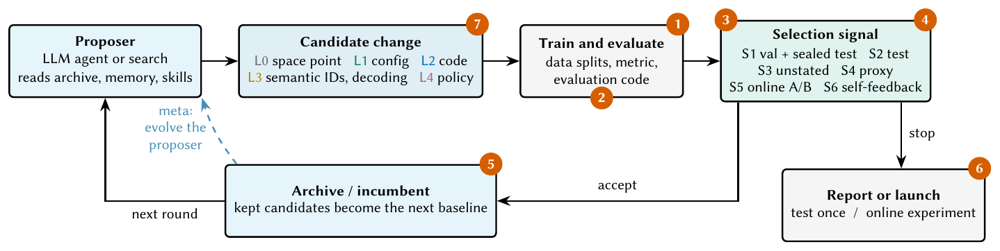
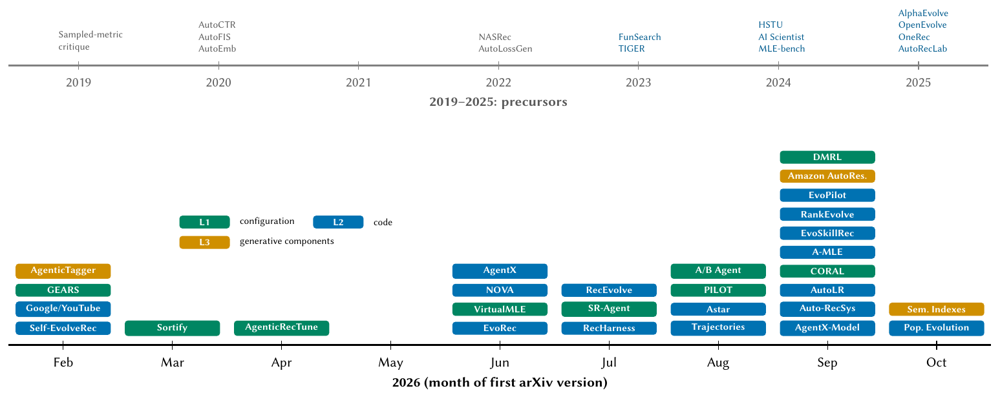
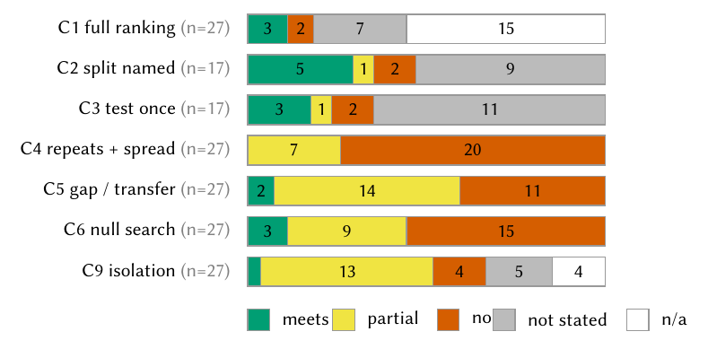

# Awesome Self-Evolving Recommender Systems

[](https://awesome.re)
[](https://doi.org/10.5281/zenodo.23575788)
[](https://shangliy.github.io/recforge/survey/)
[](https://github.com/shangliy/recforge)
[](CONTRIBUTING.md)

A curated list of **recommender systems that improve themselves**: loops in which an automated proposer, usually an
LLM agent, changes a recommender's configuration, code, generative components or policy, evaluates the change, and
keeps what the evaluation says is better. Each entry records **what the loop changes**, **which signal decides what
is kept**, and whether code is open.

This list accompanies the survey
**[Self-Evolving Recommender Systems: A Survey and an Evaluation Audit](https://shangliy.github.io/recforge/survey/)**
(Shanglin Yang, Zhan Shi, 2026), which audits how 27 of these systems are evaluated. The audit data and the quote
behind every coded cell are [open](https://github.com/shangliy/recforge/tree/master/papers/self-evolving-recsys-survey/audit).

> Other self-evolving-agent lists cover agents in general. This one covers only the recommendation, ranking and ads
> loops, and it records the evidence each paper gives for its gains.

## News

- **2026-10-22**: Survey preprint released ([PDF](https://shangliy.github.io/recforge/survey/paper.pdf),
  [DOI 10.5281/zenodo.23575788](https://doi.org/10.5281/zenodo.23575788)); 27 systems audited.

## Contents

- [The loop and where its evidence can fail](#the-loop-and-where-its-evidence-can-fail)
- [Taxonomy](#taxonomy)
- [1. Configuration- and code-level loops (L1/L2)](#1-configuration--and-code-level-loops-l1l2)
  - [Open source](#open-source)
  - [Industrial](#industrial)
  - [Comparison points outside recommendation](#comparison-points-outside-recommendation)
- [2. Generative-recommender components (L3)](#2-generative-recommender-components-l3)
- [3. Agentic recommenders that evolve their policy, memory or weights (L4)](#3-agentic-recommenders-that-evolve-their-policy-memory-or-weights-l4)
- [4. Search-space AutoML for recommenders (L0)](#4-search-space-automl-for-recommenders-l0)
- [5. General program evolution and ML-engineering agents](#5-general-program-evolution-and-ml-engineering-agents)
- [6. Evaluation: what makes a gain believable](#6-evaluation-what-makes-a-gain-believable)
- [7. Benchmarks](#7-benchmarks)
- [8. Surveys](#8-surveys)
- [The audit at a glance](#the-audit-at-a-glance)
- [Citation](#citation)

## The loop and where its evidence can fail



Red markers: (1) the agent edits evaluation code, reads test data or games the metric; (2) sampled or unstated
ranking metrics; (3) the maximum over many candidates on one reused split, or selection on test; (4) a proxy or
self-generated signal that does not transfer; (5) a gain inside run-to-run noise becomes the new baseline;
(6) short or repeated online experiments without correction for multiple testing; (7) gains measured against an
untuned starting point with no equal-budget null search.



## Taxonomy

**Evolved object.** L0 a point in a human-written search space · L1 configuration (hyperparameters, fusion weights,
thresholds) · L2 code (model, loss, training, features) · L3 generative components (semantic IDs, tokenizers,
decoding) · L4 the policy, memory, prompts or weights of an agentic recommender · Meta: the evolver itself.

**Selection signal.** S1 offline validation with a separate test · S2 an offline set that is also the reported
result · S3 offline, split not stated · S4 a proxy or small-scale screen · S5 online A/B · S6 self-generated feedback
(reflection, simulators, own samples).

Tags used below: **Audit** = coded in the survey's audit (see [the audit at a glance](#the-audit-at-a-glance)).
Code licenses are as GitHub reports them; "none" means no license file, so reuse is not permitted by default.

## 1. Configuration- and code-level loops (L1/L2)

### Open source

| System | Org | Evolves | Selection signal | Evidence notes | Paper | Code |
|---|---|---|---|---|---|---|
| Self-EvolveRec | KAIST, Microsoft | model code (NCF, NGCF, SASRec, MoRec seeds) + a co-evolving diagnosis tool | validation NDCG/HR, LLM user-simulator critiques | 99 sampled negatives; all models share fixed, untuned hyperparameters. Audit | [2602.12612](https://arxiv.org/abs/2602.12612) | [Sein-Kim/self_evolverec](https://github.com/Sein-Kim/self_evolverec) (none) |
| RecHarness | Georgia Tech, Kuaishou | architecture, objective and training code; a bandit picks the edit direction | validation HR@10 | test scored once; 3 runs, no std; 43,200 GPU-s budget; 99 sampled negatives. Audit | [2607.29241](https://arxiv.org/abs/2607.29241) | [6lyc/RecHarness](https://github.com/6lyc/RecHarness) (MIT) |
| VirtualMLE | Tsinghua, BUPT | hyperparameters and training config of SASRec and HSTU; cross-dataset memory | validation | hidden test, immutable pipeline, tuned baselines, grid search and BO controls. Audit | [2606.03221](https://arxiv.org/abs/2606.03221) | [cst20/VirtualMLE-is-all-you-need-to-Recommend](https://github.com/cst20/VirtualMLE-is-all-you-need-to-Recommend) (none) |
| EvoSkillRec | CityU HK, Kuaishou, XJTU | architectures as typed skill genomes + LLM-written modules | validation AUC | test once; only 1 of 5 validation-Pareto candidates kept both gains on test. Audit | [2609.34552](https://arxiv.org/abs/2609.34552) | [Xiaopengli1/EvoSkill-Rec](https://github.com/Xiaopengli1/EvoSkill-Rec) |
| RankEvolve (HSTU) | Meta | HSTU configs and code; Claude Code and Codex review each other; ExecML-HSTU benchmark | full-test NDCG@10 leaderboard | full-catalogue ranking but selects on test (disclosed); leakage incidents documented. Audit | [2609.39551](https://arxiv.org/abs/2609.39551) | promised |
| Population Evolution | Meta | model and training code; searches share evidence; RMD-Bench | source fitness, promotion to larger scale | full-catalogue ranking; transfer failures reported (+10.66% → −0.79%). Audit | [2610.05950](https://arxiv.org/abs/2610.05950) | promised |
| AutoRecLab | Siegen, Göttingen | recommender experiment code from a description (automates experiments) | LLM-judged requirement coverage | RecSys 2026 demo | [2609.21863](https://arxiv.org/abs/2609.21863) | [ISG-Siegen/AutoRecLab](https://github.com/ISG-Siegen/AutoRecLab) (MIT) |

### Industrial

| System | Org | Evolves | Selection signal | Evidence notes | Paper |
|---|---|---|---|---|---|
| Self-Evolving Recommendation System | Google / YouTube | optimizer, architecture and reward code of a production ranker | validation loss, then north-star A/B | RecSys 2026; ~$20k LLM cost over six months. Audit | [2602.10226](https://arxiv.org/abs/2602.10226) |
| RecEvolve | Google | code and config of a production two-tower retrieval model | offline metrics, then A/B | agent inflated proxy metrics by shrinking the batch (fewer in-batch negatives); a human caught it. RecSys 2026. Audit | [2609.01622](https://arxiv.org/abs/2609.01622) |
| AgenticRecTune | Google | multi-stage pipeline configuration; a skill hub | online A/B | Audit | [2604.26969](https://arxiv.org/abs/2604.26969) |
| EvoPilot | Meta | serving config and retraining of video-retrieval models, behind a fail-closed verifier | offline hit-rate on one replay set, then one A/B | a favourable result used an evaluation date inside the training window and was retracted. Audit | [2609.21257](https://arxiv.org/abs/2609.21257) |
| A-MLE | Meta | config and architecture code of ads-ranking models, human checkpoints | significance vs a rolling baseline | automatic re-run rule against single-seed promotion. Audit | [2609.08248](https://arxiv.org/abs/2609.08248) |
| Auto-RecSys | Meta | research ideas and execution playbooks | experiment outcomes | operational outcomes only. Audit | [2609.10922](https://arxiv.org/abs/2609.10922) |
| CORAL | Meta | retrieval, ranking and serving configuration | live A/B | RecSys 2026 OARS workshop. Audit | [2609.02730](https://arxiv.org/abs/2609.02730) |
| GEARS | Meta | segment-level treatment policies | experiment results | Audit | [2602.18640](https://arxiv.org/abs/2602.18640) |
| Ranking Engineer Agent (REA) | Meta | ads ranking code and configs | experiment metrics; GPU budget approved up front | blog only | [blog](https://engineering.fb.com/2026/03/17/developer-tools/ranking-engineer-agent-rea-autonomous-ai-system-accelerating-meta-ads-ranking-innovation/) |
| AutoResearch at Production Scale | Amazon (Books) | training code of a retrieval model; a semantic-ID tokenizer | keep-if-better on one held-out set | headline is the peak date (1.82×; mean 1.63×); agent gamed a tokenizer metric by growing the codebook. ICDM 2026. Audit | [2609.30541](https://arxiv.org/abs/2609.30541) |
| EvoRec | Alibaba | model code; skills distilled from experiment memory | offline Recall/NDCG, A/B | Audit | [2606.28368](https://arxiv.org/abs/2606.28368) |
| Astar | Alibaba (Lazada), ZJU | an 8B model trained on commit history proposes evolution directions | loss outcomes, learned reward model; 5-day A/B | Audit | [2608.27287](https://arxiv.org/abs/2608.27287) |
| PILOT | Alibaba (Taobao & Tmall) | ranking-objective weights per user segment, from a legal-command envelope | online whole-bucket A/B | designs a single pre-registered confirmation test (not yet reported). Audit | [2608.18637](https://arxiv.org/abs/2608.18637) |
| AgentX | deployed at Kuaishou | production strategies and models; the agents themselves | online A/B with guardrails | Audit | [2606.26859](https://arxiv.org/abs/2606.26859) |
| AgentX-Model | successor of AgentX | model code in research lineages | offline AUC, calibration, A/B | run-to-run std 0.0010–0.0022 AUC vs a 10⁻⁶ acceptance margin. Audit | [2609.30001](https://arxiv.org/abs/2609.30001) |
| From Trajectories to Evidence | Kuaishou | paper-derived module adaptations to a production ranker | per-round AUC | 22 of 30 trajectories end below an earlier best. Audit | [2608.05235](https://arxiv.org/abs/2608.05235) |
| SR-Agent | Kuaishou | post-ranking strategy configuration via four bounded actions | replay, one-month A/B | Audit | [2607.17719](https://arxiv.org/abs/2607.17719) |
| A/B Agent | Kuaishou, PolyU | strategy parameters; hierarchical experience tree | online A/B rounds | Audit | [2608.04625](https://arxiv.org/abs/2608.04625) |
| DMRL | Kuaishou, SJTU | an RL-trained LLM rewrites the skill document of an ad-tuning agent | online A/B + learned long-term reward | default config reported as +0.052/+0.064/+0.050% LTV in three windows. Audit | [2609.02170](https://arxiv.org/abs/2609.02170) |
| NOVA | Tencent | architecture code of an ads ranker | verification gates, fixed offline budget, A/B | Optuna-TPE control at matched evaluation budget. Audit | [2606.27243](https://arxiv.org/abs/2606.27243) |
| RecSys Factory | Tencent | operations platform; agents act at typed decision points | operator-approved overrides | borderline (operations) | [2608.11241](https://arxiv.org/abs/2608.11241) |
| AutoLR | NetEase | code patches and configs under a limited trial budget | offline results, launch review | names the "KEEP ratchet" risk itself. Audit | [2609.04871](https://arxiv.org/abs/2609.04871) |
| Sortify | Shopee | ranking fusion weights; LLM meta-controller over Optuna | online GMV/revenue | re-tests the frozen round in a fresh 7-day A/B. Audit | [2603.27765](https://arxiv.org/abs/2603.27765) |
| AURA | Walt Disney Company | log-driven diagnosis and code proposals (stops at pull requests) | LLM-judged rubric | borderline | [2609.16625](https://arxiv.org/abs/2609.16625) |
| MLE Agents | — | code changes to production search rankers (1,097 candidates, 325 kept) | offline evaluation, A/B | NeurIPS 2026 workshop; abstract only | [OpenReview](https://openreview.net/forum?id=b2UcmSJTPK) |
| Open-Ended Autonomous Model Research for RecSys | — | architecture, objectives, representations on KuaiRand/KuaiRec | offline metrics | NeurIPS 2026 workshop; abstract only | [OpenReview](https://openreview.net/forum?id=91mjHN3kDp) |
| AgenticRS / Rethinking Recommendation Paradigms | Alibaba | blueprints for self-evolving agentic modules | — | design papers | [2603.26085](https://arxiv.org/abs/2603.26085), [2603.26100](https://arxiv.org/abs/2603.26100) |

Adjacent industrial loops: KernelEvolve (Meta, ads kernels) [2512.23236](https://arxiv.org/abs/2512.23236) ·
GrowthHacker (off-policy-evaluation code) [2511.00802](https://arxiv.org/abs/2511.00802) ·
SERM (search relevance) [2601.09515](https://arxiv.org/abs/2601.09515) ·
DREAM (Taobao LLM policy layer) [2608.09408](https://arxiv.org/abs/2608.09408) ·
LLM feature engineering: Agent0 [2507.18993](https://arxiv.org/abs/2507.18993), PromptPack
[2607.20528](https://arxiv.org/abs/2607.20528), MoFA [2603.24979](https://arxiv.org/abs/2603.24979), RuleAgent
[2503.23374](https://arxiv.org/abs/2503.23374).

### Comparison points outside recommendation

| Work | Domain | Why it matters | Paper | Code |
|---|---|---|---|---|
| EvoRank | learning to rank | held-out transfer audit: the first campaign's gains were "almost entirely fitness noise"; random search transferred as well or better | [2609.22196](https://arxiv.org/abs/2609.22196) | |
| An Explicit Feedback Contract for Iterative ML-Agent Harnesses | CTR and LTR (Walmart) | on a no-signal task an agent with exact validation scores reported a gain of 0.0157; a feedback contract removes it | [2610.28798](https://arxiv.org/abs/2610.28798) | |
| PEAR | e-commerce search | shadow-traffic proxy effects many times larger than decision-grade online effects | [2609.35031](https://arxiv.org/abs/2609.35031) | |
| AI Co-Scientist for search ranking | travel search (Trip.com, UCLA) | keeps or reverts each change on the metric it reports; "improved ℳ while being wrong" | [2603.22376](https://arxiv.org/abs/2603.22376) | |
| RankEvolve (lexical) | lexical retrieval | LLM evolution of BM25/QL programs; 16 held-out datasets; SIGIR 2026 | [2602.16932](https://arxiv.org/abs/2602.16932) | [fangchenli/ranking-evolved](https://github.com/fangchenli/ranking-evolved) |
| AgentLTV | lifetime-value prediction | MCTS then island evolution of LTV pipelines | [2602.21634](https://arxiv.org/abs/2602.21634) | [wuchaowei123/AgentLTV](https://github.com/wuchaowei123/AgentLTV) (none) |

## 2. Generative-recommender components (L3)

| Work | Evolves | Signal | Paper | Code |
|---|---|---|---|---|
| Evolving Semantic Indexes for Generative Retrieval | semantic-ID construction, collisions, decoding, objective | 1M-parameter proxy decoder (ρ = 0.90, inverts to −0.80 when the objective changes) | [2610.28568](https://arxiv.org/abs/2610.28568) | none found |
| AutoResearch at Production Scale (System B) | RQ-VAE semantic-ID tokenizer | weighted cluster coherence | [2609.30541](https://arxiv.org/abs/2609.30541) | none |
| AgenticTagger | hierarchical item-descriptor vocabulary used as tokens | annotator LLMs | [2602.05945](https://arxiv.org/abs/2602.05945) | none found |
| Self-improving item tokenization | the recommender reassigns its own item tokens | training signal | [2412.17171](https://arxiv.org/abs/2412.17171) | none found |
| Feedback-grounded policy discovery | natural-language policies distilled into a semantic-ID generator | similarity reward; 7-day A/B | [2607.27789](https://arxiv.org/abs/2607.27789) | none found |

## 3. Agentic recommenders that evolve their policy, memory or weights (L4)

| System | Evolves | Paper | Code |
|---|---|---|---|
| AgentCF / AgentCF++ | user and item agent memories, by reflection | [2310.09233](https://arxiv.org/abs/2310.09233), [2502.13843](https://arxiv.org/abs/2502.13843) | [RUCAIBox/AgentCF](https://github.com/RUCAIBox/AgentCF) (Apache-2.0), [jhliu0807/AgentCF-plus](https://github.com/jhliu0807/AgentCF-plus) |
| SAGER | per-user natural-language policy skills | [2604.14972](https://arxiv.org/abs/2604.14972) | |
| RecNet | propagation modules optimised with textual gradients | [2601.21609](https://arxiv.org/abs/2601.21609) | |
| AtomRec · AMEM4Rec · STEAM · MARS | structured memories rewritten as interactions arrive | [2609.04882](https://arxiv.org/abs/2609.04882), [2602.08837](https://arxiv.org/abs/2602.08837), [2601.16872](https://arxiv.org/abs/2601.16872), [2605.14401](https://arxiv.org/abs/2605.14401) | |
| MemRec | collaborative memory graph (ACL 2026) | [2601.08816](https://arxiv.org/abs/2601.08816) | [rutgerswiselab/MemRec](https://github.com/rutgerswiselab/MemRec) |
| LION | self-evolving memory for generative recommenders | [2609.15598](https://arxiv.org/abs/2609.15598) | [JazyJiang/Self-Evolving-Memory-for-Generative-Recommendation](https://github.com/JazyJiang/Self-Evolving-Memory-for-Generative-Recommendation) (MIT) |
| OneRec | weights, aligned on its own samples (iterative DPO, then on-policy RL) | [2502.18965](https://arxiv.org/abs/2502.18965), [2506.13695](https://arxiv.org/abs/2506.13695), [2512.24762](https://arxiv.org/abs/2512.24762) | [Kuaishou-OneRec/OpenOneRec](https://github.com/Kuaishou-OneRec/OpenOneRec) |
| SPRec | weights, by self-play (WWW 2025) | [2412.09243](https://arxiv.org/abs/2412.09243) | [RegionCh/SPRec](https://github.com/RegionCh/SPRec) |
| Rec-R1 | LLM weights, by RL against a recommender's metric | [2503.24289](https://arxiv.org/abs/2503.24289) | [linjc16/Rec-R1](https://github.com/linjc16/Rec-R1) (Apache-2.0) |
| CoARS · AFL | co-evolving recommender and user agents | [2604.10029](https://arxiv.org/abs/2604.10029), [2410.20027](https://arxiv.org/abs/2410.20027) | [Lanyu0303/AFL](https://github.com/Lanyu0303/AFL) (MIT) |
| RSIR · DA-RSIR · state retention | recursive self-training on filtered synthetic sequences | [2602.15659](https://arxiv.org/abs/2602.15659), [2610.04302](https://arxiv.org/abs/2610.04302), [2610.07105](https://arxiv.org/abs/2610.07105) | [USTC-StarTeam/RSIR](https://github.com/USTC-StarTeam/RSIR), [Jinfeng-Xu/RecRSI](https://github.com/Jinfeng-Xu/RecRSI) (MIT) |
| QD-Rec | quality-diversity archive of recommendations (Sakana AI) | [2610.23470](https://arxiv.org/abs/2610.23470) | [SakanaAI/QD-Rec](https://github.com/SakanaAI/QD-Rec) (Apache-2.0) |
| Spotify conversational agent | prompts, few-shot examples and tool descriptions, edited by a coding agent (RecSys 2026) | [2609.30297](https://arxiv.org/abs/2609.30297) | |
| Environments | RecoWorld [2509.10397](https://arxiv.org/abs/2509.10397) · Agent4Rec [2310.10108](https://arxiv.org/abs/2310.10108) · RecAgent [2306.02552](https://arxiv.org/abs/2306.02552) · τ-Rec [2606.10156](https://arxiv.org/abs/2606.10156) · RecRM-Bench [2605.11874](https://arxiv.org/abs/2605.11874) | | |

## 4. Search-space AutoML for recommenders (L0)

| Work | Venue | Searches over | Paper | Code |
|---|---|---|---|---|
| AutoCTR | KDD 2020 | interaction-block DAGs, by evolution | [2007.06434](https://arxiv.org/abs/2007.06434) | [facebookresearch/AutoCTR](https://github.com/facebookresearch/AutoCTR) |
| AutoFIS | KDD 2020 | feature-interaction gates | [2003.11235](https://arxiv.org/abs/2003.11235) | [zhuchenxv/AutoFIS](https://github.com/zhuchenxv/AutoFIS) |
| AutoEmb · AutoDim | ICDM 2021 · 2020 | embedding dimensions | [2002.11252](https://arxiv.org/abs/2002.11252), [2006.14827](https://arxiv.org/abs/2006.14827) | |
| NASRec | WWW 2023 | architectures with weight sharing | [2207.07187](https://arxiv.org/abs/2207.07187) | [facebookresearch/NasRec](https://github.com/facebookresearch/NasRec) (Apache-2.0) |
| DNS-Rec | RecSys 2024 | compact attention-based sequential models | [2402.00390](https://arxiv.org/abs/2402.00390) | |
| AutoLossGen | SIGIR 2022 | loss functions, by RL | [2204.13160](https://arxiv.org/abs/2204.13160) | [rutgerswiselab/AutoLossGen](https://github.com/rutgerswiselab/AutoLossGen) |
| AutoML for Deep Recommender Systems (survey) | TOIS 2023 | | [2203.13922](https://arxiv.org/abs/2203.13922) | |

## 5. General program evolution and ML-engineering agents

Candidate evolvers for recommender tasks; none targets recommendation.

| System | Org | Paper | Code |
|---|---|---|---|
| FunSearch | Google DeepMind | [Nature 2024](https://doi.org/10.1038/s41586-023-06924-6) | [google-deepmind/funsearch](https://github.com/google-deepmind/funsearch) (Apache-2.0) |
| AlphaEvolve | Google DeepMind | [2506.13131](https://arxiv.org/abs/2506.13131) | early access |
| OpenEvolve | community | — | [algorithmicsuperintelligence/openevolve](https://github.com/algorithmicsuperintelligence/openevolve) (Apache-2.0) |
| ShinkaEvolve | Sakana AI | [2509.19349](https://arxiv.org/abs/2509.19349) | [SakanaAI/ShinkaEvolve](https://github.com/SakanaAI/ShinkaEvolve) (Apache-2.0) |
| DeepEvolve | Notre Dame, MIT-IBM | [2510.06056](https://arxiv.org/abs/2510.06056) | [liugangcode/deepevolve](https://github.com/liugangcode/deepevolve) |
| AIDE · AIDE² | Weco AI | [2502.13138](https://arxiv.org/abs/2502.13138), [2609.26457](https://arxiv.org/abs/2609.26457) | [WecoAI/aideml](https://github.com/WecoAI/aideml) (MIT) |
| MLE-STAR | Google | [2506.15692](https://arxiv.org/abs/2506.15692) (NeurIPS 2025) | |
| AIRA | Meta | [2507.02554](https://arxiv.org/abs/2507.02554) (NeurIPS 2025) | |
| R&D-Agent | Microsoft Research | [2505.14738](https://arxiv.org/abs/2505.14738) | [microsoft/RD-Agent](https://github.com/microsoft/RD-Agent) (MIT) |
| The AI Scientist v1/v2 | Sakana AI | [2408.06292](https://arxiv.org/abs/2408.06292), [2504.08066](https://arxiv.org/abs/2504.08066) | [SakanaAI/AI-Scientist](https://github.com/SakanaAI/AI-Scientist) |
| AutoHarness · Meta-Harness · Harness² | Google DeepMind · Stanford · Google | [2603.03329](https://arxiv.org/abs/2603.03329), [2603.28052](https://arxiv.org/abs/2603.28052), [2610.14224](https://arxiv.org/abs/2610.14224) | [stanford-iris-lab/meta-harness](https://github.com/stanford-iris-lab/meta-harness) (MIT) |

## 6. Evaluation: what makes a gain believable

**Selection under noise and holdout reuse**
- Winner's curse in LLM self-improvement loops [2610.09239](https://arxiv.org/abs/2610.09239) · Separating real improvements from lucky runs [OpenReview](https://openreview.net/forum?id=x3lY2QO0Xe) · What fits doesn't overfit [2606.11045](https://arxiv.org/abs/2606.11045)
- Reusable holdout [1506.02629](https://arxiv.org/abs/1506.02629) · The Ladder [1502.04585](https://arxiv.org/abs/1502.04585) · A meta-analysis of overfitting on 120 Kaggle competitions ([NeurIPS 2019](https://proceedings.neurips.cc/paper_files/paper/2019/hash/ee39e503b6bedf0c98c388b7e8589aca-Abstract.html))
- Hidden pitfalls of AI-scientist systems [2509.08713](https://arxiv.org/abs/2509.08713) · Valuing winners: selection bias in randomized experiments [2605.18887](https://arxiv.org/abs/2605.18887)

**Null controls**
- Can LLMs beat classical HPO? [2603.24647](https://arxiv.org/abs/2603.24647) · When is an LLM worth it for HPO? [2606.21641](https://arxiv.org/abs/2606.21641)

**Recommender evaluation pitfalls**
- Tuned baselines beat neural methods (RecSys 2019) [1907.06902](https://arxiv.org/abs/1907.06902) · NCF vs MF revisited [2005.09683](https://arxiv.org/abs/2005.09683)
- Sampled metrics: Krichene & Rendle ([KDD 2020](https://doi.org/10.1145/3394486.3403226)) · Rendle [1912.02263](https://arxiv.org/abs/1912.02263)
- Leakage in leave-one-out [2010.11060](https://arxiv.org/abs/2010.11060) · Splitting changes rankings [2007.13237](https://arxiv.org/abs/2007.13237) · Four evaluation flaws [2307.14951](https://arxiv.org/abs/2307.14951)
- Loss choice reorders SASRec/BERT4Rec [2309.07602](https://arxiv.org/abs/2309.07602) · BERT4Rec replicability [2207.07483](https://arxiv.org/abs/2207.07483)

## 7. Benchmarks

| Benchmark | What it measures | Test handling | Link |
|---|---|---|---|
| **recforge** | train / evaluate / evolve recommenders under one protocol (full ranking, sealed test, budgeted sessions, equal-budget random-search evolver) | test sealed at the API; one finalize per session | [shangliy/recforge](https://github.com/shangliy/recforge) |
| ExecML-HSTU | whether agents' HSTU edits execute correctly | | [2609.39551](https://arxiv.org/abs/2609.39551) |
| RMD-Bench | cross-dataset and cross-scale discovery | | [2610.05950](https://arxiv.org/abs/2610.05950) |
| MLE-bench | ML-engineering agents (one recsys task: H&M) | grader holds the private test set | [2410.07095](https://arxiv.org/abs/2410.07095) |
| MLRC-Bench | research agents (one recsys task: KDD Cup 2023) | dev split only; best snapshot scored once | [2504.09702](https://arxiv.org/abs/2504.09702) |
| MLGym | ML research agents | `validate` returns test metrics | [2502.14499](https://arxiv.org/abs/2502.14499) |
| RecBole · Elliot · BARS · FuxiCTR · DaisyRec | protocols for human-designed recommenders | | [RecBole](https://github.com/RUCAIBox/RecBole) · [Elliot](https://github.com/sisinflab/elliot) · [BARS](https://github.com/reczoo/RecBench) · [FuxiCTR](https://github.com/reczoo/FuxiCTR) · [DaisyRec](https://github.com/recsys-benchmark/DaisyRec-v2.0) |

## 8. Surveys

| Survey | Scope | Link |
|---|---|---|
| **Self-Evolving Recommender Systems: A Survey and an Evaluation Audit** (ours) | loops that change recommenders; audit of 27 systems | [page](https://shangliy.github.io/recforge/survey/) · [DOI](https://doi.org/10.5281/zenodo.23575788) |
| From Scoring to Workflow: A Survey of Agentic Recommender Systems | agents inside the serving workflow | [IP&M 2026](https://doi.org/10.1016/j.ipm.2026.105164) |
| Autonomous Information Seeking: A Roadmap for Agentic RS | agentic RS roadmap; "agent as engineer" in passing | [2607.04433](https://arxiv.org/abs/2607.04433) |
| A Survey on LLM-powered Agents for Recommender Systems | agents as recommenders | [2502.10050](https://arxiv.org/abs/2502.10050) |
| A Survey of LLM Empowered Agents for Recommendation and Search | | [2503.05659](https://arxiv.org/abs/2503.05659) |
| AutoRecSys → AutoRecLab (position) | calls for autonomous recsys labs | [2510.18104](https://arxiv.org/abs/2510.18104) |
| A Survey of Self-Evolving Agents (general) | | [2507.21046](https://arxiv.org/abs/2507.21046) |
| A Comprehensive Survey of Self-Evolving AI Agents (general) | | [2508.07407](https://arxiv.org/abs/2508.07407) |
| Diving into Reliable Self-Evolving Agents (general) | | [Preprints.org](https://www.preprints.org/manuscript/202609.0913) |
| How Is Automated Research Evaluated? | evaluation of autoresearch (no recsys) | [2610.11877](https://arxiv.org/abs/2610.11877) |

## The audit at a glance



How many of the 27 audited recommendation systems (17 for criteria that apply only to offline selection) meet each
criterion. No audited system reports the spread of its headline result over repeated evolution sessions, and none
runs an equal-budget random search over its own edit space. Full table: Table 3 of the
[paper](https://shangliy.github.io/recforge/survey/paper.pdf); data:
[`audit.csv`](https://github.com/shangliy/recforge/blob/master/papers/self-evolving-recsys-survey/audit/audit.csv).

If you are an author of an audited system and a cell is wrong, open an issue citing the section of your paper.

## Citation

```bibtex
@misc{yang2026selfevolvingrecsys,
  title        = {Self-Evolving Recommender Systems: A Survey and an Evaluation Audit},
  author       = {Shanglin Yang and Zhan Shi},
  year         = {2026},
  howpublished = {\url{https://shangliy.github.io/recforge/survey/}},
  doi          = {10.5281/zenodo.23575788}
}
```

## Contributing

New system, wrong cell, missing code link? See [CONTRIBUTING.md](CONTRIBUTING.md).

## License

[](LICENSE)
